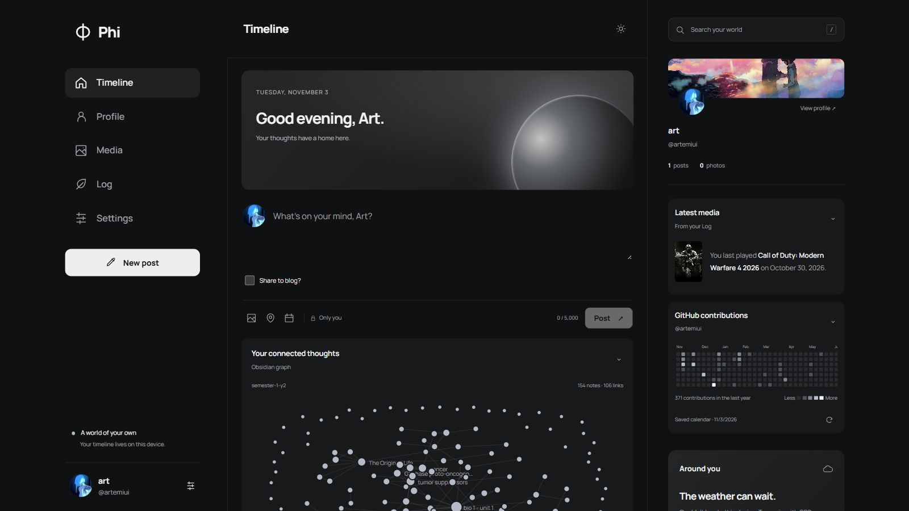
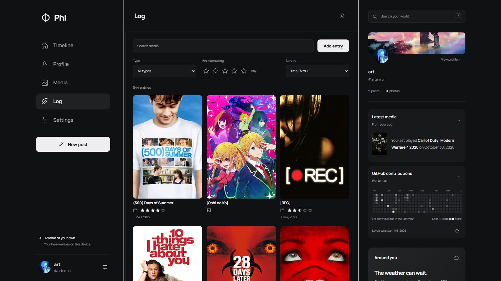

# Phi

A local personal timeline with text, photos, math, calendars, GitHub contributions, and an Obsidian graph.

## Previews

Screenshots show my personal setup. Blog sharing is a private customization.





## Setup

Install Node.js 22.13 or newer, then run:

```sh
git clone https://github.com/artemiui/phi.git
cd phi
npm ci
npm run dev
```

Open http://localhost:3000. Refresh the browser after frontend changes. Use `npm start` to run without file watching.

## Customize

Open Settings to edit your profile and enable optional widgets. Enter your own GitHub username, Obsidian vault path, or calendar links. Each widget can appear in the timeline or right sidebar. The profile preview stays above sidebar widgets.

The Log stores movies, anime, games, manga, and books in SQLite. Add ratings, dates, covers, and notes, then search or filter entries. Covers load from the URLs you provide.

## Data

Data is stored in `data/phi.sqlite` and excluded from Git. Use Settings to export or import a backup. Keep backups and secret calendar links private. Phi runs on localhost for personal use.

Set `PORT` to change the port or `PHI_DATA_DIR` to use another data folder.

## Tests

```sh
npm test
```
